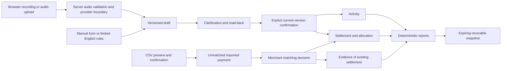

# Architecture and accounting decisions

One Next.js App Router application hosts React screens and server route handlers. Better Auth owns credentials, secure cookie sessions and authentication rate limits. Every application route derives the business from the authenticated user's membership; clients cannot select a business ID. PostgreSQL provides persistence for records, binary evidence, sessions, import decisions, reports and audit events. Prisma manages the schema and transactions; Zod validates external data.

## Invariants

- All monetary input is a decimal string in **naira**; internal/storage money is `bigint` **kobo**; API totals serialize kobo as decimal strings. Never use JavaScript floating point for final money. Quantities allow three decimal places; multiplication must resolve exactly to whole kobo.
- Economic `Activity` is SALE, EXPENSE or INVENTORY. Payment is `Settlement`, IN or OUT. `Allocation` links money to activity. Credit sales are SALE with zero/partial initial allocation. Collections only create settlement/allocation. An uploaded invoice is supporting evidence, not a second sale.
- A ₦40,000 sale and ₦15,000 collection produce sales 4,000,000 kobo; receipts 1,500,000; receivables 2,500,000. A matching CSV row supplies evidence without adding another receipt. CSV unmatched payments never count as sales or cash movement.
- Every financial mutation acquires a PostgreSQL `FOR UPDATE` lock on its Business row before reading balances. This deliberately simple prototype serializes concurrent confirmations, corrections, imports and allocations per business across server processes. Unique draft, import, reference and matching keys provide idempotency. Transactions roll back on any failed invariant.
- Initial payments cannot exceed totals. Allocations cannot exceed both available payment and current debt. Imported transfers with the same amount remain distinct when references differ. Reference conflicts with changed details stop the import.
- Corrections atomically void original activity/direct settlements/allocations and create a linked replacement only after the replacement is confirmed. Original records, versions and audit reasons remain. Later settlements or matches block corrections, avoiding silent reassignment. Unsupported refunds/reversals are rejected.
- Business event dates are validated YYYY-MM-DD local Lagos dates, not UTC timestamps. System timestamps are UTC. Reports include activity/cash within inclusive start/end dates; debt includes all activity through period end and only payments through that date. Backdated corrections restate historical reports; already-shared snapshots remain fixed.
- Coverage denominator is unique active economic activities in the period. The numerator is unique records with any supporting document or payment match. Document and payment categories may overlap. Supported-record value is not verified value; actual matched payment amounts are shown separately. No score, profit or repayment-capacity inference.

## Security boundaries

Server-side providers; same-origin mutation checks; persistent database rate limits; schema validation; bounded upload size and WAV duration; magic-byte evidence checks; escaped React rendering; formula-safe evaluation CSV export; private file download checks. Transcripts are untrusted input. No provider output can bypass read-back/version confirmation or create arbitrary queries. Six query intents map to fixed calculations.

Report links contain 256-bit random secrets. Only SHA-256 digests persist. Links expire after 1–168 hours and are revocable. Snapshot data is limited to aggregate totals, activity dates/types/amounts and evidence labels. No account identifiers, aliases, transcripts, file URLs or merchant navigation.

Prototype tradeoffs: one owner per business, serialized financial writes, full activity lists in memory, bytea evidence storage, no email transport, no automatic retention scheduler. These keep correctness reviewable; production scale needs pagination, storage quotas, asynchronous media processing, monitoring and an operational review.
